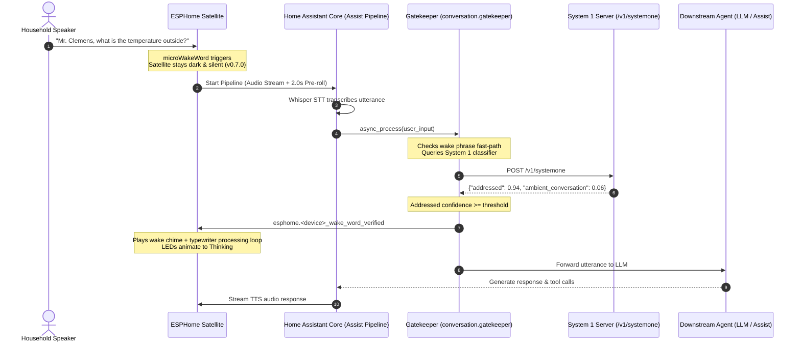

# ESPHome Satellite Gatekeeper Integration

The **ESPHome Satellite Gatekeeper** is a Home Assistant custom conversation integration that provides sub-200ms neural addressing gating and fast-path wake word verification for voice satellites running `esphome-satellite`.

It operates as a transparent gatekeeper between Home Assistant's Voice Assistant pipeline and your downstream Large Language Model (LLM) or conversational agent (such as Local OpenAI, Anthropic, Fireworks AI, or Home Assistant Assist).

---

## Why Gatekeeper?

Edge acoustic wake-word engines (`microWakeWord`) running on microcontrollers like the ESP32-S3 must strike a delicate balance between high recall (waking reliably on conversational speech) and avoiding false triggers from ambient room dialogue, television, podcasts, or music.

Gatekeeper decouples acoustic wake-word detection from speech execution:
1. **High Recall Edge Trigger**: The satellite can run sensitive wake thresholds without risking false home automation actions or chatter.
2. **Deferred Physical Feedback**: Starting in firmware `v0.7.0`, the satellite remains 100% silent and dark during speech capture and transcription. Wake chimes and LED animations only activate once Gatekeeper confirms the speech is addressed to the assistant.
3. **Fast-Path Wake Word Enforcement**: Utterances lacking the expected wake word or its phonetic variants are dropped immediately in Python before incurring network latency.
4. **Default-Drop / Fail-Closed Policy**: Only utterances explicitly classified as addressed with confidence meeting or exceeding the threshold are approved. Ambient dialogue, TV chatter, and low-confidence speech are silently dropped.
5. **Zero-Token Silent Rejection**: Ambient chatter is intercepted and dropped immediately with zero downstream LLM tokens consumed and zero audio/TTS response from the satellite.
6. **Sub-200ms Evaluation**: Utterance classification is delegated to a dedicated System 1 neural addressing model (such as Laya / ModernBERT) with low latency.

---

## Sequence Architecture



If the utterance was ambient chatter (e.g., *"We were reading Mark Twain yesterday in class"*):
- Fast-path verification or System 1 identifies non-addressed dialogue.
- Gatekeeper immediately returns an empty response (`speech=""`).
- Home Assistant core skips TTS and closes the turn.
- The satellite never chimes, never lights up, and immediately returns to `Idle`.

---

## Installation

### Method 1: HACS Custom Repository (Recommended)

1. Ensure **HACS** (Home Assistant Community Store) is installed.
2. In Home Assistant, open **HACS > Integrations**.
3. Click the three dots menu in the top right corner and select **Custom repositories**.
4. Enter the repository URL:
   ```text
   https://github.com/axiomantic/esphome-satellite
   ```
   Set Category to **Integration**, then click **Add**.
5. Search for **ESPHome Satellite Gatekeeper** in HACS, click **Download**, and confirm.
6. Restart Home Assistant:
   **Developer Tools > YAML > Restart** (or `ha core restart`).

### Method 2: Manual Installation

1. Copy the `custom_components/esphome_satellite` directory into your Home Assistant `/config/custom_components/` directory:
   ```bash
   # From your development machine or terminal
   scp -r custom_components/esphome_satellite root@<homeassistant_ip>:/config/custom_components/
   ```
2. Ensure directory permissions are readable by Home Assistant:
   ```bash
   chmod -R 755 /config/custom_components/esphome_satellite
   ```
3. Restart Home Assistant:
   **Developer Tools > YAML > Restart** (or `ha core restart`).

---

## Configuration

### 1. Add the Integration

1. In Home Assistant, navigate to **Settings > Devices & Services**.
2. Click **Add Integration** in the bottom right corner.
3. Search for **ESPHome Satellite Gatekeeper** and select it.
4. Fill in the initial setup dialog:
   - **Downstream Conversation Agent**: Select your existing Conversation Agent (e.g., `conversation.openai`, `conversation.fireworks_ai`, or `conversation.home_assistant`).
   - **System 1 Endpoint URL**: The HTTP URL of your System 1 inference endpoint (e.g., `http://10.0.0.10:8000/v1/systemone`).
   - **API Bearer Token**: (Optional) Bearer token if your System 1 server requires authentication.
   - **Default Threshold**: Minimum confidence score required to approve an utterance (default: `0.60`).
5. Click **Submit**. The integration entity will appear as `conversation.<title>`.

### 2. Configure Options Flow

To customize thresholds, patterns, or behaviors at any time:
1. Navigate to **Settings > Devices & Services > ESPHome Satellite Gatekeeper**.
2. Click **Configure** (the gear icon):
   - **Downstream Conversation Agent**: Switch or update the target LLM.
   - **System 1 URL & Token**: Update endpoint credentials without restarting.
   - **Enforce Wake Word Presence (Fast-Path Rejection)**: When enabled (default: `true`), transcripts that lack the expected wake word or its phonetic variants are dropped immediately.
   - **Slot 1 Gatekeeper Enabled**: Toggle gating for Slot 1 (primary wake word).
   - **Slot 1 Confidence Threshold**: Minimum confidence for Slot 1 (0.10 to 0.95, default: `0.60`).
   - **Slot 1 Custom Wake Word Regex**: (Optional) Custom regular expression for Slot 1.
   - **Slot 2 Gatekeeper Enabled**: Toggle gating for Slot 2 (secondary wake word).
   - **Slot 2 Confidence Threshold**: Minimum confidence for Slot 2 (0.10 to 0.95, default: `0.60`).
   - **Slot 2 Custom Wake Word Regex**: (Optional) Custom regular expression for Slot 2.
   - **Classification Timeout**: Timeout in seconds for System 1 requests (default: `2.5s`).
   - **Fallback Policy**:
     - `Fail-Closed (Drop Command)` (default): Drop the utterance silently if System 1 is unreachable or times out.
     - `Fail-Open (Allow Command)`: Forward utterance downstream if System 1 is unreachable.
3. Click **Submit** to apply changes immediately.

### 3. Assign Gatekeeper to Assist Pipeline

1. In Home Assistant, navigate to **Settings > Voice Assistants**.
2. Select your voice pipeline (or create a new one).
3. Under **Conversation Agent**, select **ESPHome Satellite Gatekeeper**.
4. Click **Save**.

---

## Hardware Notification Contract

When an utterance is verified as addressed, Gatekeeper looks up the originating satellite in the Home Assistant Entity Registry and calls:
```text
esphome.<device_name>_wake_word_verified
```
This triggers the satellite's native ESPHome action:
- Transitions the state machine from `Verifying -> Thinking`.
- Initiates wake chime playback if enabled.
- Begins the looping typewriter processing sound.
- Activates the LED ring thinking animation.

If your ESPHome satellite does not implement `_wake_word_verified`, Gatekeeper catches the missing service call gracefully and still delegates the conversation downstream to the LLM.

---

## Debugging & Logs

To monitor Gatekeeper decisions and timings in real-time, add the following to your `configuration.yaml`:
```yaml
logger:
  default: info
  logs:
    custom_components.esphome_satellite: debug
```
Sample log output:
```text
[Gatekeeper] APPROVED addressed utterance on satellite assist_satellite.living_room (Slot 1, conf=0.96, rtt=18.4ms): 'Mr. Clemens, turn on the lights'
[Gatekeeper] INTERCEPTED non-addressed speech on satellite assist_satellite.living_room (Slot 1, wake='Mr. Clemens', choice='ambient', conf=0.88, rtt=14.2ms): 'We were discussing Mark Twain earlier'
[Gatekeeper] REJECTED utterance missing wake word on satellite assist_satellite.living_room (Slot 1, wake='Mr. Clemens'): 'turn off the tv'
```

---

## Unit Testing

Run the isolated unit and regression test suite directly via Python's standard `unittest`:
```bash
python3 -m unittest tests/test_systemone_gatekeeper.py
```
Tests verify fail-open/fail-closed behaviors, mock network timeouts, threshold boundaries, OptionsFlow schema generation, fast-path wake word regex matching, and entity registry resolution.
