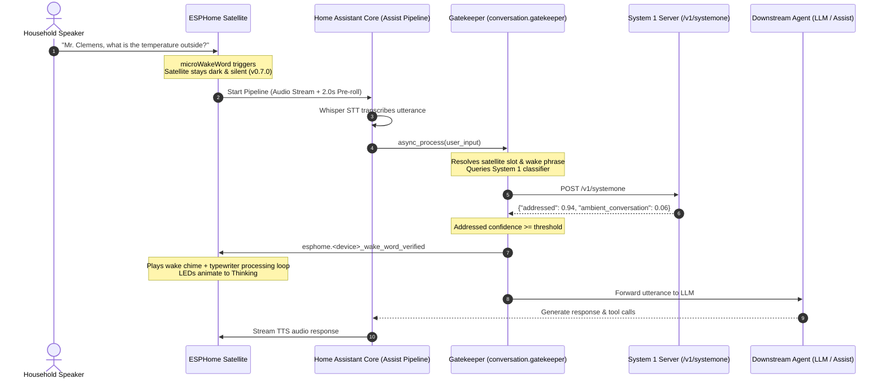

# ESPHome Satellite Gatekeeper Integration

The **ESPHome Satellite Gatekeeper** is a Home Assistant custom conversation integration that provides sub-200ms neural addressing gating for voice satellites running `esphome-satellite`.

It operates as a transparent gatekeeper between Home Assistant's Voice Assistant pipeline and your primary downstream Large Language Model (LLM) or conversation agent (e.g., Local OpenAI, Anthropic, Fireworks AI, or Home Assistant Assist).

---

## Why Gatekeeper?

Edge acoustic wake-word engines (`microWakeWord`) running on microcontrollers like the ESP32-S3 must strike a balance between high recall (waking reliably on conversational speech) and avoiding false triggers from ambient room dialogue, television, or music.

Gatekeeper decouples acoustic wake-word detection from speech execution:
1. **High Recall Edge Trigger**: The satellite can run sensitive wake thresholds without risking false home automation actions.
2. **Deferred Physical Feedback**: Starting in firmware `v0.7.0`, the satellite remains 100% silent and dark during speech capture and transcription. Wake chimes and LED animations only activate once Gatekeeper confirms the speech is addressed to the assistant.
3. **Zero-Token Silent Rejection**: Ambient dialogue or TV chatter is intercepted and dropped immediately with zero downstream LLM tokens burned and zero audio/TTS response from the satellite.
4. **Sub-200ms Evaluation**: Utterance classification is delegated to a dedicated System 1 neural addressing model (such as Laya / ModernBERT) with low latency.

---

## Sequence Architecture



If the utterance was ambient chatter (e.g., *"We were reading Mark Twain yesterday in class"*):
- System 1 returns `ambient_conversation` confidence $\ge 0.60$.
- Gatekeeper immediately returns an empty response (`speech=""`).
- Home Assistant core skips TTS and closes the turn.
- The satellite never chimes, never lights up, and immediately returns to `Idle`.

---

## Installation

### Method 1: Manual Installation

1. Copy the `custom_components/esphome_satellite` directory into your Home Assistant `/config/custom_components/` directory:
   ```bash
   cp -r custom_components/esphome_satellite /config/custom_components/
   ```
2. Restart Home Assistant:
   **Developer Tools > YAML > Restart** (or `ha core restart`).

### Method 2: HACS Custom Repository

1. Open **HACS > Integrations**.
2. Click the three dots in the top right corner and select **Custom repositories**.
3. Add the repository URL: `https://github.com/axiomantic/esphome-satellite` with category **Integration**.
4. Search for **ESPHome Satellite Gatekeeper**, click **Download**, and restart Home Assistant.

---

## Configuration

### 1. Add the Integration

1. In Home Assistant, navigate to **Settings > Devices & Services**.
2. Click **Add Integration** and search for **ESPHome Satellite Gatekeeper**.
3. Configure the initial parameters:
   - **Integration Title**: Friendly name (e.g., `Mark Twain Gatekeeper`).
   - **System 1 URL**: Endpoint URL of your System 1 inference service (e.g., `http://laya.flanopticon.lan/v1/systemone` or `http://localhost:8000/v1/systemone`).
   - **System 1 Token**: Bearer authentication token for the service.
   - **Downstream Agent**: Select your existing Conversation Agent (e.g., `conversation.fireworks_ai_...`, `conversation.openai`, or `conversation.home_assistant`).
   - **Default Threshold**: Minimum confidence score for classification (default: `0.60`).
4. Click **Submit**.

### 2. Configure Options Flow

To modify thresholds or behavioral settings at any time, click **Configure** (the gear icon) on the integration card:
- **Downstream Conversation Agent**: Select which agent receives verified requests.
- **System 1 URL & Token**: Update service endpoint credentials without restarting.
- **Slot 1 Gatekeeper Enabled**: Toggle gating for Slot 1 wake word.
- **Slot 1 Confidence Threshold**: Sensitivity threshold for Slot 1 (0.0 to 1.0).
- **Slot 2 Gatekeeper Enabled**: Toggle gating for Slot 2 wake word.
- **Slot 2 Confidence Threshold**: Sensitivity threshold for Slot 2 (0.0 to 1.0).
- **Classification Timeout**: Timeout in seconds for System 1 queries (default: `2.5s`).
- **Fallback Behavior**:
  - `allow` (default): Pass utterance downstream to the LLM if the System 1 service is unreachable (fail-open).
  - `drop`: Silently drop the utterance if the System 1 service is unreachable (fail-closed).

### 3. Assign Gatekeeper to Assist Pipeline

1. In Home Assistant, navigate to **Settings > Voice Assistants**.
2. Select your voice pipeline (or create a new one).
3. Under **Conversation Agent**, select **Gatekeeper** (or the custom title you assigned).
4. Save the pipeline.

---

## Hardware Notification Contract

When an utterance is verified as addressed, Gatekeeper looks up the originating satellite in the Home Assistant Entity Registry and calls:
```text
esphome.<device_name>_wake_word_verified
```
This triggers the satellite's native ESPHome action:
- Transitions the state machine from `Verifying -> Thinking`.
- Initiates wake chime playback if enabled.
- Begins the looping typewriter processing sound.
- Activates the LED ring thinking animation.

---

## Unit Testing

Run the isolated unit and regression test suite directly via Python's standard `unittest`:
```bash
python3 -m unittest tests/test_systemone_gatekeeper.py
```
Tests verify fail-open/fail-closed behaviors, mock network timeouts, threshold boundaries, OptionsFlow schema generation, and entity registry resolution.
