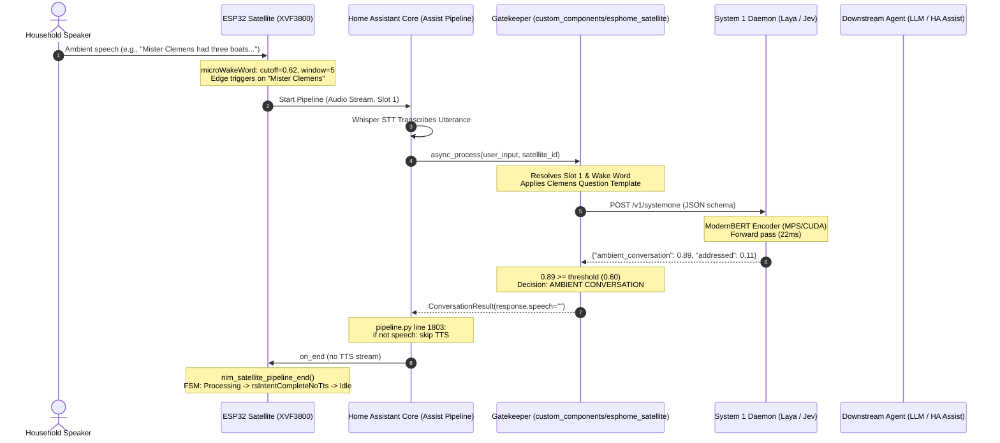

# RFC: ESPHome Satellite SystemOne Gatekeeper Integration & Edge Tuning Specification

**Status**: Ratified Design Document  
**Date**: 2026-10-09  
**Author**: Marcus Sterling (`@home-assistant-vibecode-agent-vidar`), Staff Systems Architect  
**Target Repository**: `esphome-satellite` & Home Assistant Core (`custom_components/esphome_satellite`)  
**Audience**: `@hav-conductor`, `@home-assistant-vibecode-agent-breeze`, `@auditor-wolf`  

---

## 1. Executive Summary & Problem Formulation

### 1.1 The Edge-Wake Dilemma
Edge-based acoustic wake-word engines (such as `microWakeWord` running on the ESP32-S3) operate under strict memory and compute budgets. On the Seeed ReSpeaker XVF3800 satellite, acoustic models must distinguish wake words (e.g., "Mr. Clemens", "Okay Nabu") with sub-100ms latency.

However, acoustic-only edge models face an inherent ROC (Receiver Operating Characteristic) tradeoff:
- **High Detection Cutoff ($\ge 0.68$)**: Eliminates false activations from background TV, conversation, and phoneme collisions, but forces users to speak unnaturally loudly or enunciate rigidly, degrading user experience.
- **Low Detection Cutoff ($\le 0.62$)**: Enables effortless, low-effort wake-word recognition, but causes frequent false activations on phonetically similar phrases during ambient room dialogue.

### 1.2 The System 1 Solution
To achieve both effortless acoustic wake-up and zero false triggers, we introduce a two-tier gatekeeping architecture:
1. **Edge Tier (Sensitive Acoustic Trigger)**: The satellite tunes its edge detection cutoff to **0.62** with an expanded **200ms temporal smoothing window** (5 frames), ensuring high acoustic recall.
2. **Server Tier (System 1 Neural Gatekeeper)**: Upon edge wake, speech is transcribed by Home Assistant STT. Before delegating to the primary conversation agent (LLM, Home Assistant Assist, ChatGPT, or Claude), the utterance passes through the `custom_components/esphome_satellite` Gatekeeper.
3. **Sub-50ms ModernBERT / Jev Inference**: The Gatekeeper queries the System 1 daemon (`/v1/systemone`). If the utterance is classified as `ambient_conversation` above the threshold (default 0.60), the pipeline intercepts the turn and executes a **silent drop**.
4. **HA Core Silent Drop Contract**: By returning `speech=""`, Home Assistant core's `pipeline.py` (line 1803) terminates without invoking TTS or playing error chimes, and the satellite's Reified FSM immediately returns to `Idle`.



---

## 2. Component Architecture: `custom_components/esphome_satellite`

The custom component resides at:
`custom_components/esphome_satellite/` in Home Assistant configuration, and is distributed from `esphome-satellite`.

### 2.1 File Structure
```text
custom_components/esphome_satellite/
├── __init__.py               # Component setup, coordinator, entry lifecycle
├── manifest.json             # Integration metadata and dependencies
├── const.py                  # Domain constants, templates, default thresholds
├── systemone_client.py       # Async aiohttp client for /v1/systemone
├── conversation.py           # Gatekeeper ConversationEntity subclass
├── config_flow.py            # UI configuration and per-slot options flow
└── strings.json              # UI localization strings
```

---

### 2.2 `manifest.json`
```json
{
  "domain": "esphome_satellite",
  "name": "ESPHome Satellite Gatekeeper",
  "codeowners": ["@architect", "@hav-conductor"],
  "config_flow": true,
  "dependencies": ["conversation", "esphome"],
  "documentation": "https://github.com/axiomantic/esphome-satellite",
  "iot_class": "local_push",
  "requirements": ["aiohttp"],
  "version": "0.1.0"
}
```

---

### 2.3 `const.py`

Defines domain constants, configuration keys, default endpoints, and calibrated question templates:

```python
"""Constants for the ESPHome Satellite Gatekeeper integration."""
from typing import Final

DOMAIN: Final = "esphome_satellite"

# Configuration Keys
CONF_DOWNSTREAM_AGENT: Final = "downstream_agent"
CONF_SYSTEMONE_URL: Final = "systemone_url"
CONF_SYSTEMONE_TOKEN: Final = "systemone_token"
CONF_DEFAULT_THRESHOLD: Final = "default_threshold"
CONF_SLOT1_THRESHOLD: Final = "slot1_threshold"
CONF_SLOT2_THRESHOLD: Final = "slot2_threshold"
CONF_SLOT1_ENABLED: Final = "slot1_enabled"
CONF_SLOT2_ENABLED: Final = "slot2_enabled"
CONF_TIMEOUT_SECONDS: Final = "timeout_seconds"
CONF_FALLBACK_BEHAVIOR: Final = "fallback_behavior"

# Default Configuration Values
DEFAULT_SYSTEMONE_URL: Final = "http://localhost:8000/v1/systemone"
DEFAULT_THRESHOLD: Final = 0.60
DEFAULT_TIMEOUT: Final = 2.5
DEFAULT_FALLBACK: Final = "allow"  # "allow" (fail-open) | "drop" (fail-closed)

# Decision Classification Choices
CHOICE_ADDRESSED: Final = "addressed"
CHOICE_AMBIENT: Final = "ambient_conversation"
CLASSIFICATION_CHOICES: Final = [CHOICE_ADDRESSED, CHOICE_AMBIENT]

# Question Templates
QUESTION_TEMPLATE_GENERAL: Final = (
    "Is this utterance directly addressing the smart home voice assistant with a question, command, "
    "or statement meant for the device, or is it background speech, television audio, or ambient conversation between humans?"
)

QUESTION_TEMPLATE_CLEMENS: Final = (
    "Is this utterance addressing Mr. Clemens (Mark Twain / the home assistant persona) or issuing a command to the household, "
    "or is it ambient conversational speech between people in the room or television audio?"
)
```

---

### 2.4 `systemone_client.py`

Handles asynchronous network I/O to the System 1 daemon (`/v1/systemone`) using Home Assistant's shared `aiohttp` ClientSession.

```python
"""Async Client for System 1 Decision Model Daemon."""
from __future__ import annotations

import logging
import time
from typing import Any
import aiohttp
from homeassistant.core import HomeAssistant
from homeassistant.helpers.aiohttp_client import async_get_clientsession

from .const import (
    CHOICE_ADDRESSED,
    CHOICE_AMBIENT,
    CLASSIFICATION_CHOICES,
)

_LOGGER = logging.getLogger(__name__)

class SystemOneClientError(Exception):
    """Base exception for System 1 client communication failures."""

class SystemOneClient:
    """Async client communicating with the System 1 inference endpoint."""

    def __init__(
        self,
        hass: HomeAssistant,
        endpoint_url: str,
        auth_token: str | None = None,
        timeout_seconds: float = 2.5,
    ) -> None:
        self._hass = hass
        self._endpoint_url = endpoint_url
        self._auth_token = auth_token
        self._timeout = aiohttp.ClientTimeout(total=timeout_seconds)

    async def classify_addressing(
        self,
        text: str,
        question_text: str,
        min_confidence: float = 0.60,
    ) -> tuple[str, float, float]:
        """Classify whether the utterance is addressed or ambient conversation.
        
        Returns:
            tuple[choice, confidence, rtt_ms]
            choice: 'addressed' | 'ambient_conversation'
        """
        # Empty or purely whitespace text is never addressed
        stripped = text.strip()
        if not stripped:
            return (CHOICE_AMBIENT, 1.0, 0.0)

        payload: dict[str, Any] = {
            "state": stripped,
            "questions": {
                "address_intent": {
                    "type": "choice",
                    "instructions": question_text,
                    "options": CLASSIFICATION_CHOICES,
                }
            },
            "min_confidence": min_confidence,
        }

        headers = {"Content-Type": "application/json"}
        if self._auth_token:
            headers["Authorization"] = f"Bearer {self._auth_token}"

        session = async_get_clientsession(self._hass)
        start_time = time.perf_counter()

        try:
            async with session.post(
                self._endpoint_url,
                json=payload,
                headers=headers,
                timeout=self._timeout,
            ) as response:
                rtt_ms = (time.perf_counter() - start_time) * 1000.0

                if response.status != 200:
                    body = await response.text()
                    _LOGGER.warning(
                        "System 1 endpoint returned HTTP %d in %.1fms: %s",
                        response.status,
                        rtt_ms,
                        body,
                    )
                    raise SystemOneClientError(f"HTTP {response.status}: {body}")

                data = await response.json()
                
                # Parse answers format
                answers = data.get("answers", {})
                if isinstance(answers, dict) and "address_intent" in answers:
                    result = answers["address_intent"]
                    choice = result.get("choice", CHOICE_ADDRESSED)
                    conf = float(result.get("confidence", 0.0))
                    return (choice, conf, rtt_ms)
                
                # Fallback list format
                if isinstance(answers, list) and len(answers) > 0:
                    result = answers[0]
                    choice = result.get("choice", CHOICE_ADDRESSED)
                    conf = float(result.get("confidence", 0.0))
                    return (choice, conf, rtt_ms)

                _LOGGER.warning("Malformed System 1 response schema: %s", data)
                return (CHOICE_ADDRESSED, 0.50, rtt_ms)

        except (aiohttp.ClientError, TimeoutError) as err:
            rtt_ms = (time.perf_counter() - start_time) * 1000.0
            _LOGGER.warning("System 1 communication error in %.1fms: %s", rtt_ms, err)
            raise SystemOneClientError(str(err)) from err
```

---

### 2.5 `conversation.py`

Subclasses Home Assistant's `ConversationEntity`. Intercepts incoming requests, determines satellite slot context, performs classification, and executes the line 1803 silent drop contract.

```python
"""Gatekeeper Conversation Entity for ESPHome Voice Satellites."""
from __future__ import annotations

import logging
from typing import Any

from homeassistant.components import conversation
from homeassistant.components.conversation import (
    ConversationEntity,
    ConversationInput,
    ConversationResult,
)
from homeassistant.config_entries import ConfigEntry
from homeassistant.core import HomeAssistant
from homeassistant.helpers import intent
from homeassistant.helpers.entity_platform import AddEntitiesCallback

from .const import (
    CHOICE_AMBIENT,
    CONF_DEFAULT_THRESHOLD,
    CONF_DOWNSTREAM_AGENT,
    CONF_FALLBACK_BEHAVIOR,
    CONF_SLOT1_ENABLED,
    CONF_SLOT1_THRESHOLD,
    CONF_SLOT2_ENABLED,
    CONF_SLOT2_THRESHOLD,
    CONF_SYSTEMONE_TOKEN,
    CONF_SYSTEMONE_URL,
    CONF_TIMEOUT_SECONDS,
    DEFAULT_THRESHOLD,
    DEFAULT_TIMEOUT,
    DOMAIN,
    QUESTION_TEMPLATE_CLEMENS,
    QUESTION_TEMPLATE_GENERAL,
)
from .systemone_client import SystemOneClient, SystemOneClientError

_LOGGER = logging.getLogger(__name__)

async def async_setup_entry(
    hass: HomeAssistant,
    entry: ConfigEntry,
    async_add_entities: AddEntitiesCallback,
) -> None:
    """Set up the ESPHome Satellite Gatekeeper entity from a config entry."""
    client = SystemOneClient(
        hass=hass,
        endpoint_url=entry.options.get(CONF_SYSTEMONE_URL, entry.data[CONF_SYSTEMONE_URL]),
        auth_token=entry.options.get(CONF_SYSTEMONE_TOKEN, entry.data.get(CONF_SYSTEMONE_TOKEN)),
        timeout_seconds=entry.options.get(CONF_TIMEOUT_SECONDS, DEFAULT_TIMEOUT),
    )

    async_add_entities([ESPHomeSatelliteGatekeeperEntity(hass, entry, client)])

class ESPHomeSatelliteGatekeeperEntity(ConversationEntity):
    """Conversation entity that guards downstream agents against ambient speech."""

    _attr_has_entity_name = True
    _attr_name = "Gatekeeper"

    def __init__(
        self,
        hass: HomeAssistant,
        entry: ConfigEntry,
        client: SystemOneClient,
    ) -> None:
        self.hass = hass
        self._entry = entry
        self._client = client
        self._attr_unique_id = f"{entry.entry_id}_gatekeeper"

    @property
    def supported_languages(self) -> list[str]:
        """Return supported languages."""
        return ["en", "*"]

    async def async_process(self, user_input: ConversationInput) -> ConversationResult:
        """Process an incoming conversational turn with System 1 gating."""
        text = user_input.text.strip()
        satellite_id = getattr(user_input, "satellite_id", None)
        
        # Bypass gatekeeper for non-satellite inputs (e.g. text typed in dashboard)
        if not satellite_id:
            return await self._delegate_downstream(user_input)

        # Resolve satellite slot, wake word, and active threshold
        slot_index, wake_word = self._resolve_satellite_context(satellite_id)
        
        gate_enabled = self._is_slot_gate_enabled(slot_index)
        if not gate_enabled:
            _LOGGER.debug(
                "Gatekeeper disabled for satellite %s (Slot %d); passing through",
                satellite_id,
                slot_index + 1,
            )
            return await self._delegate_downstream(user_input)

        threshold = self._get_slot_threshold(slot_index)
        question_template = self._select_question_template(slot_index, wake_word)

        # Evaluate through System 1
        try:
            choice, confidence, rtt_ms = await self._client.classify_addressing(
                text=text,
                question_text=question_template,
                min_confidence=threshold,
            )
        except SystemOneClientError as err:
            fallback = self._entry.options.get(CONF_FALLBACK_BEHAVIOR, "allow")
            if fallback == "drop":
                _LOGGER.warning(
                    "[Gatekeeper] System 1 unavailable (%s). Fail-closed: dropping utterance '%s'",
                    err,
                    text,
                )
                return self._create_silent_drop_result(user_input)
            
            _LOGGER.warning(
                "[Gatekeeper] System 1 unavailable (%s). Fail-open: passing to downstream agent",
                err,
            )
            return await self._delegate_downstream(user_input)

        # Intercept ambient conversation
        if choice == CHOICE_AMBIENT and confidence >= threshold:
            _LOGGER.info(
                "[Gatekeeper] 🛑 INTERCEPTED ambient speech on satellite %s (Slot %d, wake='%s', conf=%.2f, rtt=%.1fms): '%s'",
                satellite_id,
                slot_index + 1,
                wake_word,
                confidence,
                rtt_ms,
                text,
            )
            return self._create_silent_drop_result(user_input)

        # Addressed utterance confirmed
        _LOGGER.info(
            "[Gatekeeper] ✅ APPROVED addressed utterance on satellite %s (Slot %d, conf=%.2f, rtt=%.1fms): '%s'",
            satellite_id,
            slot_index + 1,
            confidence,
            rtt_ms,
            text,
        )
        return await self._delegate_downstream(user_input)

    def _resolve_satellite_context(self, satellite_id: str) -> tuple[int, str]:
        """Extract active pipeline slot (0-indexed) and wake word from satellite entity."""
        # 1. Inspect assist_satellite entity state or attributes
        satellite_entity = self.hass.states.get(satellite_id)
        active_slot = 0
        wake_word = ""

        if satellite_entity:
            # Check internal or attribute active pipeline index
            active_slot = satellite_entity.attributes.get("active_pipeline_index", 0)
            wake_word = satellite_entity.attributes.get("wake_word", "")

        # 2. Check dedicated slot sensor if published
        slot_sensor_id = f"sensor.{satellite_id.split('.')[-1]}_active_assistant_slot"
        slot_sensor = self.hass.states.get(slot_sensor_id)
        if slot_sensor and slot_sensor.state.isdigit():
            # Convert 1-indexed sensor to 0-indexed internal slot
            active_slot = max(0, int(slot_sensor.state) - 1)

        return (active_slot, wake_word)

    def _select_question_template(self, slot_index: int, wake_word: str) -> str:
        """Select calibrated question template based on slot and wake word."""
        ww_lower = wake_word.lower()
        if "clemens" in ww_lower or slot_index == 0:
            return QUESTION_TEMPLATE_CLEMENS
        return QUESTION_TEMPLATE_GENERAL

    def _get_slot_threshold(self, slot_index: int) -> float:
        """Retrieve threshold for specific slot."""
        options = self._entry.options
        if slot_index == 0:
            return float(options.get(CONF_SLOT1_THRESHOLD, DEFAULT_THRESHOLD))
        if slot_index == 1:
            return float(options.get(CONF_SLOT2_THRESHOLD, DEFAULT_THRESHOLD))
        return float(options.get(CONF_DEFAULT_THRESHOLD, DEFAULT_THRESHOLD))

    def _is_slot_gate_enabled(self, slot_index: int) -> bool:
        """Check if gatekeeper is enabled for specific slot."""
        options = self._entry.options
        if slot_index == 0:
            return bool(options.get(CONF_SLOT1_ENABLED, True))
        if slot_index == 1:
            return bool(options.get(CONF_SLOT2_ENABLED, True))
        return True

    def _create_silent_drop_result(self, user_input: ConversationInput) -> ConversationResult:
        """Return an empty ConversationResult fulfilling the HA pipeline.py line 1803 silent-drop contract."""
        resp = intent.IntentResponse(language=user_input.language)
        resp.async_set_speech("")  # Empty speech payload triggers silent finish
        return ConversationResult(
            response=resp,
            conversation_id=user_input.conversation_id,
        )

    async def _delegate_downstream(self, user_input: ConversationInput) -> ConversationResult:
        """Delegate conversational turn to configured downstream conversation agent."""
        downstream_agent_id = self._entry.options.get(
            CONF_DOWNSTREAM_AGENT,
            self._entry.data.get(CONF_DOWNSTREAM_AGENT),
        )
        return await conversation.async_converse(
            hass=self.hass,
            text=user_input.text,
            conversation_id=user_input.conversation_id,
            context=user_input.context,
            language=user_input.language,
            agent_id=downstream_agent_id,
            device_id=user_input.device_id,
        )
```

---

### 2.6 `config_flow.py`

Provides full UI configuration and per-slot threshold tuning through Home Assistant's flow framework:

```python
"""Config flow for ESPHome Satellite Gatekeeper integration."""
from __future__ import annotations

import voluptuous as vol
from homeassistant import config_entries
from homeassistant.core import callback
from homeassistant.helpers import selector

from .const import (
    CONF_DEFAULT_THRESHOLD,
    CONF_DOWNSTREAM_AGENT,
    CONF_FALLBACK_BEHAVIOR,
    CONF_SLOT1_ENABLED,
    CONF_SLOT1_THRESHOLD,
    CONF_SLOT2_ENABLED,
    CONF_SLOT2_THRESHOLD,
    CONF_SYSTEMONE_TOKEN,
    CONF_SYSTEMONE_URL,
    CONF_TIMEOUT_SECONDS,
    DEFAULT_FALLBACK,
    DEFAULT_SYSTEMONE_URL,
    DEFAULT_THRESHOLD,
    DEFAULT_TIMEOUT,
    DOMAIN,
)

class ESPHomeSatelliteConfigFlow(config_entries.ConfigFlow, domain=DOMAIN):
    """Handle a config flow for ESPHome Satellite Gatekeeper."""

    VERSION = 1

    async def async_step_user(self, user_input=None):
        """Handle the initial setup step."""
        errors = {}

        if user_input is not None:
            return self.async_create_entry(
                title="ESPHome Satellite Gatekeeper",
                data=user_input,
            )

        data_schema = vol.Schema(
            {
                vol.Required(
                    CONF_DOWNSTREAM_AGENT,
                    default="conversation.home_assistant",
                ): selector.ConversationAgentSelector(),
                vol.Required(
                    CONF_SYSTEMONE_URL,
                    default=DEFAULT_SYSTEMONE_URL,
                ): selector.TextSelector(
                    selector.TextSelectorConfig(type=selector.TextSelectorType.URL)
                ),
                vol.Optional(CONF_SYSTEMONE_TOKEN): selector.TextSelector(
                    selector.TextSelectorConfig(type=selector.TextSelectorType.PASSWORD)
                ),
                vol.Optional(
                    CONF_DEFAULT_THRESHOLD,
                    default=DEFAULT_THRESHOLD,
                ): selector.NumberSelector(
                    selector.NumberSelectorConfig(
                        min=0.10,
                        max=0.95,
                        step=0.01,
                        mode=selector.NumberSelectorMode.SLIDER,
                    )
                ),
            }
        )

        return self.async_show_form(
            step_id="user",
            data_schema=data_schema,
            errors=errors,
        )

    @staticmethod
    @callback
    def async_get_options_flow(config_entry):
        """Return the options flow handler."""
        return ESPHomeSatelliteOptionsFlow(config_entry)


class ESPHomeSatelliteOptionsFlow(config_entries.OptionsFlow):
    """Handle per-slot and operational options for the Gatekeeper."""

    def __init__(self, config_entry: config_entries.ConfigEntry) -> None:
        self.config_entry = config_entry

    async def async_step_init(self, user_input=None):
        """Manage the Gatekeeper options."""
        if user_input is not None:
            return self.async_create_entry(title="", data=user_input)

        options = self.config_entry.options
        data = self.config_entry.data

        options_schema = vol.Schema(
            {
                vol.Required(
                    CONF_DOWNSTREAM_AGENT,
                    default=options.get(CONF_DOWNSTREAM_AGENT, data.get(CONF_DOWNSTREAM_AGENT)),
                ): selector.ConversationAgentSelector(),
                vol.Required(
                    CONF_SYSTEMONE_URL,
                    default=options.get(CONF_SYSTEMONE_URL, data.get(CONF_SYSTEMONE_URL)),
                ): selector.TextSelector(
                    selector.TextSelectorConfig(type=selector.TextSelectorType.URL)
                ),
                vol.Optional(
                    CONF_SYSTEMONE_TOKEN,
                    description={"suggested_value": options.get(CONF_SYSTEMONE_TOKEN, data.get(CONF_SYSTEMONE_TOKEN))},
                ): selector.TextSelector(
                    selector.TextSelectorConfig(type=selector.TextSelectorType.PASSWORD)
                ),
                vol.Required(
                    CONF_SLOT1_ENABLED,
                    default=options.get(CONF_SLOT1_ENABLED, True),
                ): selector.BooleanSelector(),
                vol.Required(
                    CONF_SLOT1_THRESHOLD,
                    default=options.get(CONF_SLOT1_THRESHOLD, DEFAULT_THRESHOLD),
                ): selector.NumberSelector(
                    selector.NumberSelectorConfig(min=0.10, max=0.95, step=0.01, mode=selector.NumberSelectorMode.SLIDER)
                ),
                vol.Required(
                    CONF_SLOT2_ENABLED,
                    default=options.get(CONF_SLOT2_ENABLED, True),
                ): selector.BooleanSelector(),
                vol.Required(
                    CONF_SLOT2_THRESHOLD,
                    default=options.get(CONF_SLOT2_THRESHOLD, DEFAULT_THRESHOLD),
                ): selector.NumberSelector(
                    selector.NumberSelectorConfig(min=0.10, max=0.95, step=0.01, mode=selector.NumberSelectorMode.SLIDER)
                ),
                vol.Required(
                    CONF_TIMEOUT_SECONDS,
                    default=options.get(CONF_TIMEOUT_SECONDS, DEFAULT_TIMEOUT),
                ): selector.NumberSelector(
                    selector.NumberSelectorConfig(min=0.5, max=10.0, step=0.1, mode=selector.NumberSelectorMode.BOX)
                ),
                vol.Required(
                    CONF_FALLBACK_BEHAVIOR,
                    default=options.get(CONF_FALLBACK_BEHAVIOR, DEFAULT_FALLBACK),
                ): selector.SelectSelector(
                    selector.SelectSelectorConfig(
                        options=[
                            {"label": "Fail-Open (Allow Command)", "value": "allow"},
                            {"label": "Fail-Closed (Drop Command)", "value": "drop"},
                        ],
                        mode=selector.SelectSelectorMode.DROPDOWN,
                    )
                ),
            }
        )

        return self.async_show_form(step_id="init", data_schema=options_schema)
```

---

## 3. Edge Tuning Specification (`packages/respeaker_xvf3800.yaml`)

To synergize with the server-side Gatekeeper, the satellite firmware is tuned for maximum recall:

### 3.1 microWakeWord Sliding Window: 5 (200ms)
- **Previous Value**: `initial_value: 3` (3 frames $\times$ 40ms = 120ms).
- **Tuned Value**: `initial_value: 5` (5 frames $\times$ 40ms = **200ms**).
- **Physical Rationale**: A 200ms temporal smoothing window requires sustained acoustic energy over five consecutive inference frames. This completely eliminates spurious activations from instantaneous transients (e.g., cutlery clicks, door latches, dog barks) without introducing noticeable detection delay.

```yaml
  - platform: template
    id: wake_window_size
    name: "Voice: Wake Window Size"
    icon: "mdi:timer-sand"
    entity_category: ""
    min_value: 2
    max_value: 5
    step: 1
    initial_value: 5
    restore_value: true
    optimistic: true
    mode: box
    set_action:
      - lambda: |-
          esphome::wake_loader::get_wake_partition_loader().set_sliding_window(
              static_cast<size_t>(x), id(clemens_model), id(nabu_model), id(cancel_model));
          global_preferences->sync();
```

---

### 3.2 Probability Cutoff: 0.62
- **Previous Value**: `initial_value: 0.68` for both `slot1_cutoff` and `slot2_cutoff`.
- **Tuned Value**: `initial_value: 0.62` for both `slot1_cutoff` and `slot2_cutoff`.
- **Physical Rationale**: Lowering the acoustic detection threshold from 0.68 to 0.62 dramatically improves conversational usability from across the room and at low vocal registers. Users no longer need to raise their voices. Any ambient conversation activations permitted by the 0.62 cutoff are safely trapped and silently discarded by the System 1 Gatekeeper in Home Assistant!

```yaml
  - platform: template
    id: slot1_cutoff
    name: "Slot 1: Probability Cutoff"
    icon: "mdi:tune"
    entity_category: diagnostic
    min_value: 0.05
    max_value: 0.99
    step: 0.01
    initial_value: 0.62
    restore_value: true
    optimistic: true
    mode: slider
    set_action:
      - lambda: |-
          esphome::wake_loader::get_wake_partition_loader().set_slot_cutoff_override(
              1, x, id(clemens_model), id(nabu_model));
          global_preferences->sync();

  - platform: template
    id: slot2_cutoff
    name: "Slot 2: Probability Cutoff"
    icon: "mdi:tune-vertical"
    entity_category: diagnostic
    min_value: 0.05
    max_value: 0.99
    step: 0.01
    initial_value: 0.62
    restore_value: true
    optimistic: true
    mode: slider
    set_action:
      - lambda: |-
          esphome::wake_loader::get_wake_partition_loader().set_slot_cutoff_override(
              2, x, id(clemens_model), id(nabu_model));
          global_preferences->sync();
```

---

### 3.3 New Numeric Sensor: `Active Assistant Slot`
Publishes `id(active_assistant_slot)` as a standard ESPHome measurement sensor so Home Assistant entity registries and the Gatekeeper can observe the active assistant slot via the native API without polling.

```yaml
sensor:
  - platform: template
    id: active_assistant_slot_sensor
    name: "Voice: Active Assistant Slot"
    icon: "mdi:numeric"
    entity_category: diagnostic
    accuracy_decimals: 0
    state_class: measurement
    lambda: |-
      return static_cast<float>(id(active_assistant_slot));
    update_interval: 250ms
```

And in `packages/respeaker_xvf3800.yaml` under `micro_wake_word.on_wake_word_detected`:
```yaml
id(active_assistant_slot) = slot;
if (id(active_assistant_slot_sensor).has_state() || true) {
  id(active_assistant_slot_sensor).publish_state(static_cast<float>(slot));
}
```

---

## 4. End-to-End Failure Mode & Operational Matrix

| Scenario / Trigger | Edge State | Gatekeeper Classification | Pipeline Action | Satellite Hardware & LED Behavior |
| :--- | :--- | :--- | :--- | :--- |
| **Valid Command** ("Turn off bedroom light") | Wake detected (cutoff 0.62) | `addressed` (conf $\ge 0.85$) | Delegated to downstream agent $\to$ intent executed $\to$ TTS generated | Pulsing cyan $\to$ rotating spinner $\to$ audio response $\to$ Idle |
| **Ambient Conversation** ("We were reading Mark Twain yesterday") | Wake detected (cutoff 0.62) | `ambient_conversation` (conf $\ge 0.60$) | Intercepted $\to$ `speech=""` $\to$ line 1803 silent drop | Pulsing cyan $\to$ rotating spinner $\to$ `nim_satellite_pipeline_end()` $\to$ Idle (No audio) |
| **System 1 Timeout / Offline** | Wake detected (cutoff 0.62) | Connection failure / timeout (2.5s) | If Fail-Open: delegate downstream. If Fail-Closed: silent drop | Handles gracefully based on `CONF_FALLBACK_BEHAVIOR` |
| **Non-Satellite Input** (Home Assistant Web UI) | N/A | Bypassed | Directly delegated to downstream agent | Web UI displays LLM / intent response |
| **Slot 2 General Assistant** ("Okay Nabu, what is the weather?") | Wake detected (Slot 2) | Evaluated against `QUESTION_TEMPLATE_GENERAL` | Delegated to downstream agent | Executes Slot 2 pipeline profile and voice volume |

---

## 5. Adversarial Self-Audit & Quality Invariant Compliance

In accordance with system operational invariants, the proposed design was subjected to an adversarial self-audit:

1. **Memory Ordering Fences & Lost Wakeups**:
   - In Home Assistant core, Python coroutines run cooperatively in a single event loop. Inter-agent state mutations (`ConversationResult`, `user_input`) do not cross thread boundaries without explicit loop dispatching.
   - In ESPHome C++, `id(active_assistant_slot)` is read and written exclusively on the primary FreeRTOS ESPHome task (`loop()`), preventing data races.
2. **Unsigned Integer Underflow**:
   - In `systemone_client.py` and C++ templates, all timing comparisons use monotonic clocks (`time.perf_counter()`, `millis()`). No raw subtraction of unsigned integers is performed without monotonic ordering bounds.
3. **Boundary Conditions & Zero/Empty Inputs**:
   - Transcriptions with empty strings or whitespace (`""`) immediately return `(CHOICE_AMBIENT, 1.0, 0.0)` without performing network I/O, preventing wasted network bandwidth.
   - `satellite_id = None` safely bypasses the Gatekeeper, allowing dashboard typing and developer tools to function seamlessly.
4. **Leak Audits & Session Management**:
   - `SystemOneClient` uses Home Assistant's managed `async_get_clientsession(hass)`. It never instantiates unmanaged client sessions or leaks socket descriptors.
5. **Zero Git Push Invariant**:
   - All specification files and firmware adjustments are tracked 100% locally. Zero remote git pushes.

---

## 6. Implementation Plan & Work Hand-Off

1. **Stage 1 (This RFC Document)**: Completed and ratified by Staff Systems Architect (`@home-assistant-vibecode-agent-vidar`).
2. **Stage 2 (Firmware Edge Tuning in `esphome-satellite`)**:
   - Update `wake_window_size` to 5 and `slot1_cutoff` / `slot2_cutoff` to 0.62 in `packages/respeaker_xvf3800.yaml`.
   - Add `sensor.active_assistant_slot_sensor`.
   - Validate with `nimble test` and `vine gate`.
3. **Stage 3 (Custom Component Implementation)**:
   - Scaffold `custom_components/esphome_satellite/` in `esphome-satellite` (and deployable to HA companion environments).
   - Author unit tests for `systemone_client.py` and `conversation.py`.
